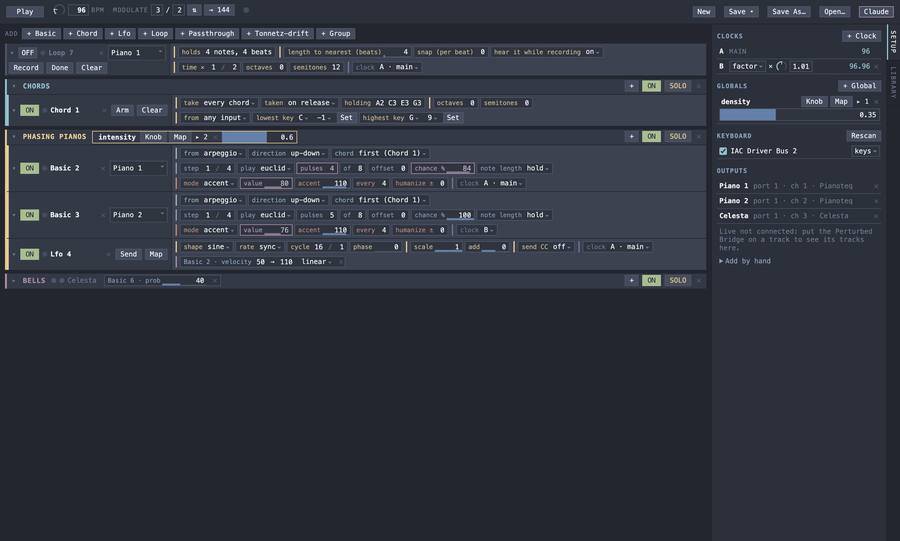

# Perturbed

An algorithmic performance instrument. You play chords on a MIDI keyboard; generators running on
shared clocks turn them into arpeggios, permutations, euclidean rhythms, phasing and polytempo
layers, and send the MIDI to instruments in Ableton Live. You shape it all live from the Perturbed app.



**Claude** (the button, or ⌘`) opens a drawer running Claude Code as a performance assistant:
describe the piece and it sets up the performance ([AGENTS.md](AGENTS.md)).

## AI Disclosure

This code base was written by AI. The developer merely designed the software. 

## Post-Mortem

(In this section, AI only fixed spelling.)

This was an experiment in using AI to facilitate new methods for musical creation and improvisation. 

The notion of adding a Claude terminal embedded was a smart idea. 

The vibe coded approach where the developer only provided high level ideas and feedback led to 
an architecture that was not only overly reliant on the early decisions for a POC, but it also
led to a static approach, which didn't allow for any kind of sense of form or phrase. As such,
this could be more quickly implemented in SC directly, or Strudel. 

The lesson learned here is that architecture and design needs to be refined before we get to the point of
implementation, at least as much as it would lead to future capabilities.

## Requirements

- macOS, [SuperCollider](https://supercollider.github.io/) 3.14 in `/Applications`
- [Ableton Live](https://www.ableton.com/) with the instruments you want (the defaults use
  Pianoteq 9); Max for Live for the bridge device (optional so far)
- Node.js (for the app) and Xcode command-line tools (to build the drawer's terminal);
  ImageMagick only to regenerate the icon
- [Claude Code](https://claude.com/claude-code), logged in, for the Claude drawer
- A MIDI keyboard

## One-time setup

1. **IAC buses:** Audio MIDI Setup → Window → Show MIDI Studio → IAC Driver: enable, with
   *Bus 1* and *Bus 2*. The brain sends on these; Live listens.
2. **Live:** Settings → Link, Tempo & MIDI: turn **Track** on for the inputs *IAC Driver (Bus 1)*
   and *(Bus 2)*, and off for your keyboard (it reaches Live through the brain's passthrough).
   For *IAC Driver (Perturbed CTL 1)* and *(Perturbed CTL 2)* turn **Remote** on and Track off:
   the control buses for LFOs.
   Turn on **Show Link Toggle** there, then the **Link** button at the top left of Live's window:
   Live and Perturbed then share tempo and bar lines.
3. **Bridge:** put `ableton/Perturbed Bridge.amxd` (Max for Live) on any track. It shows
   Perturbed which Live tracks listen to the brain.
4. **Tracks:** a sound is a Live MIDI track with MIDI From *IAC Driver (Bus n)*, a channel no
   other track uses, Monitor **In**, not armed, an instrument on it. It appears under *In Live*
   in Perturbed's Outputs pane; **+** makes it an output. Save the set as
   `ableton/Perturbed Project/Perturbed.als`.

## Run

```
./run.sh
```

Starts the brain and opens Perturbed; quitting Perturbed stops the brain. A keyboard plugged in
later is found with **Rescan** in the sidebar's Keyboard section. The first run builds
`build/Perturbed.app` from Electron.

## Playing

- **Chords:** a chord lives in a **chord strip** in the rack (a new performance has one, in a group called *Chords* that you can
  fold away; *+ Chord* adds more). It listens to the keyboard and holds the last chord for the generators. *take*: every chord,
  only the next one (**Arm**), or hold. *taken*: *on release* (the chord replaces the old one when the
  last key comes up) or *as played* (it builds up key by key until the last key comes up). *holding*
  shows the chord and can be typed (`A2 C3 E3`); **Clear** empties it. *octaves* and *semitones*
  transpose what the generators hear. *from* and the key range make it listen to one keyboard or one
  part of it. Off, it keeps its chord. Generators read the **main** chord (the first chord strip) unless
  their *chord* setting picks another. Other types can hold chords too and show in the same menu: the
  library has *Progression* (chords it steps through in time: press **Record** and play them, or type
  them as note names, `A2 C3 E3 | F2 A2 C3`) and *Tonnetz-drift* (a triad that
  wanders by itself), and Claude can write more.
- **Outputs:** Live's tracks on the IAC buses are listed under *In Live*; **+** (or *Add all*)
  makes them outputs. A **!** marks an output no Live track listens to.
- **Keyboard:** the sidebar lists the keyboards and controllers Perturbed hears (keys and knobs).
  Untick one to ignore it; **Rescan** finds one plugged in after starting. Set a pad controller
  to **control**: its notes then never reach the chord, only switch things. The choices are
  remembered on this machine.
- **On/off keys:** right-click a generator's strip or a group's header → *Learn on/off key…*, then play a key
  or hit a pad: that note now switches it on and off, and the chord ignores it (on any keyboard).
- **Globals:** *+ Global* adds a global parameter (Meta 1, …; click the name to rename): one slider
  for many settings. Press its **Map**, click setting names on strips, press **Done**; ▸ shows the
  mappings: *from → to* in the setting's units (from > to inverts it) and a curve (linear, exp,
  steps, threshold). A mapped setting is locked and outlined in purple (hover it to see what it follows).
  **Knob**: press it, turn a knob or fader on your controller, and the global follows it (× forgets it).
  Several globals can follow the same knob, each with its own *knob response* (under ▸): linear,
  invert, exp, log, or a formula in x such as `x * x` or `(x * 2 - 1).abs`.
- **Setup and Library:** the tabs on the window's right edge open the Setup panel (clocks, globals,
  keyboard, outputs) or the Library in the same place; click the open tab to hide it and give the
  generators the whole width.
- **Values:** drag across a value with a line under it to change it (shift for fine steps; it moves
  from where it is), or double-click it to type.
- **Library:** the add bar holds your favorite generator types; the **Library** tab lists every type
  (with a search box),
  built-in and AdHoc (written by Claude for a piece, kept in `adhoc/`), with ☆ to star one for the
  bar, *+ Add*, and × to delete an AdHoc type (its file moves to `adhoc/old/`). Errors from a type show at the top right.
- **Moving strips:** drag a strip by its header onto another strip to put it before or after that
  one; onto a group (its area, or its header when folded) to put it in the group; onto the top
  area to take it out. The order is saved with the performance.
- **Right-click** a generator's strip for *Duplicate* (a copy with the same settings, output and
  group, switched off), *Move to* a group, Fold and Remove; right-click a group's header for *Rename*, Fold, Solo
  and Remove.
- **Folding:** ▾ (or a click on a strip's name) folds a generator down to its header: On/Off, light,
  name, output. Folded strips stay folded when you save and reopen.
- **Generators:** *+ Basic* adds a generator. Pick an output, turn it *On*, press *Play* (or
  space). Set where its pitch comes from (a note or the chord: index, lowest, highest, arpeggio,
  permute), its rhythm (every, euclid, random, phrase on a num/den grid, with a *chance* per note
  and a note length: hold, or a percentage of the step) and velocity (set,
  accent, random, drift, ramp, pattern, humanize).
- **Groups:** *+ Group* makes a section; put generators in it by dragging them, or right-click one →
  *Move to …*. **On/Off**
  and **Solo** mute without losing time (a group comes back on the beat); ▸ folds it away to a
  header with a light per generator. Click the name to rename; **+** in the header adds a
  generator straight into the group. Right-click a setting's name → *Pin* puts it on the group's header (◆ marks it), so it
  stays at hand when the group is folded.
- **A group's own globals:** **+** in a group's header → *Global* (or right-click the header) puts a
  global on the header itself: name, Knob, Map, ▸ mappings and its value, just like the ones in Setup,
  but there with the layer and still at hand when the group is folded. Removing the group moves them
  to Setup.
- **Loops:** *+ Loop* is a loop recorder. Pick an output, press **Record**, play, press **Done**: the
  loop is everything from your first note to Done, its length rounded to the nearest *length to
  nearest* beats (4 by default), and it plays while it's On and the transport runs. Recorded while the
  transport plays, it keeps its place in the bar. *snap* tidies the timing when the loop is made.
  Playback is transformed without changing the recording: *time ×* 1/2 is diminution (twice as fast,
  twice as often), 2/1 augmentation; *octaves* and *semitones* transpose. **Clear** empties it.
- **Passthrough:** *+ Passthrough* plays the keyboard into an output: transposed, zoned, delayed.
- **LFOs:** *+ Lfo* is a slow wave (synced to the beat or free) that moves things. **Settings:**
  press **Map** on its strip, click setting names on other strips, press **Done**; each target gets
  its own *from → to* at the end of the LFO's strip, and is locked and outlined while driven (another LFO's
  Hz or phase can be a target). *scale* and *add* shape everything an LFO moves; map a global to
  *scale* to fade its effect in and out. **MIDI CC** to Live (*send CC*): ⌘M in Live, click the parameter,
  press the strip's **Send** (or let the LFO run) until Live learns it, ⌘M; the range of each
  mapping is set in Live's mapping browser.
- **Tempo:** the dial (drag, shift for fine, scroll, double-click to type); *Modulate* multiplies
  the tempo by a fraction and ⇅ flips it back.
- **Clocks:** A is the main clock. Add B, C… at a ratio or factor of it (1.01 phases slowly), or
  at their own tempo, and put generators on them.
- **New** (⌘N) starts a new performance: one chord strip in a *Chords* group, and nothing else (no
  outputs: add them from *In Live*). **Save** (⌘S)
  writes the performance to its file, asking for a name the first time; **Save As…** (⌘⇧S) always
  asks; **Open…** (⌘O). Performances live in `performances/` (`example.json` is a demo). The
  window title shows the file's name, with a dot while there are unsaved changes; closing the
  window, New and Open… ask before losing them.

## Develop

```
npm install         # once, at the repo root: the JavaScript linter/formatter (Biome)
./tests/run.sh      # lint, then the test suites the changed files can break (it prints which), on a separate test brain
./tests/run.sh --all   # every suite (~65 s: timing and generators play in real time); before a push
npm run format      # fix formatting and safe lint findings in the JavaScript (biome.jsonc)
```

```
brain/     SuperCollider: clocks, chords, generators, groups, globals, MIDI, OSC protocol (the authority)
  types/     built-in generator types (basic, chord, lfo, loop, passthrough); a new file here is a new type
surface/   the Perturbed app (Electron): ui, transport, generators (strips), groups, globals, library,
           sidebar (Setup and the dock), app (state + protocol), terminal (the Claude drawer)
tools/     perturbed: change the running performance from the shell (tools/perturbed help)
adhoc/     the AdHoc type library (written by Claude: progression, tonnetz-drift, …), favorites.json,
           old/ (replaced versions)
ableton/   the Live set and the Perturbed Bridge (Max for Live: bridge.js)
tests/     run.sh (picks suites by what changed) and the tests it runs
performances/  saved performances
archive/   the first proof of concept
```

Rig settings (IAC ports, control buses, MIDI inputs, latency) are in `brain/config.scd`.
**Writing your own generator types:** [docs/writing-generator-types.md](docs/writing-generator-types.md).
Architecture, protocol, plans and gotchas: [PLAN.md](PLAN.md). Rules for coding agents and for
Claude as performance assistant: [AGENTS.md](AGENTS.md).
